<div align="center">

# Lazaro Guerra · Portfolio

**Personal portfolio of a Java backend engineer** — Java, Spring Boot, Kafka, PostgreSQL and AWS.<br/>
Built with Angular 20 and Tailwind CSS v4, bilingual (ES / EN), deployed to GitHub Pages.

[](https://lazarodevelop.github.io/portfolio-website/)

[](https://github.com/LazaroDevelop/portfolio-website/actions/workflows/ci.yml)
[](https://github.com/LazaroDevelop/portfolio-website/actions/workflows/deploy-pages.yml)


<br/>

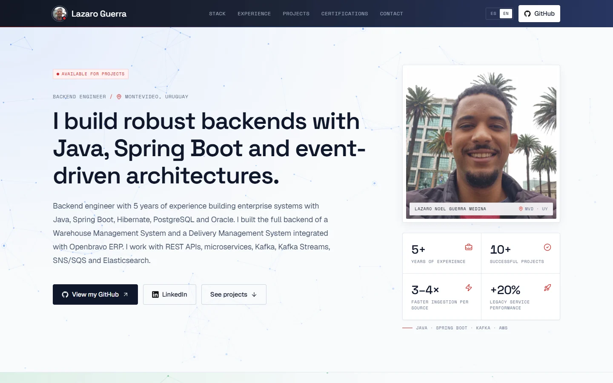

</div>

---

## Preview

### Mobile

<table>
  <tr>
    <td align="center">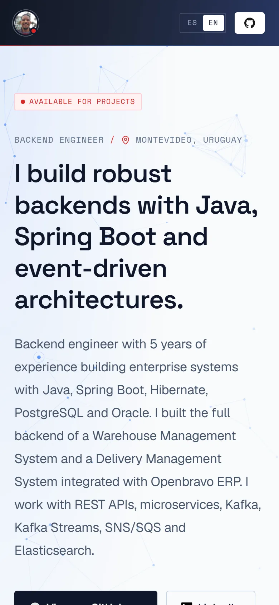<br/><sub>Home</sub></td>
    <td align="center">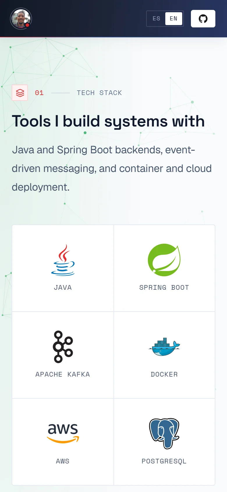<br/><sub>Tech stack</sub></td>
    <td align="center">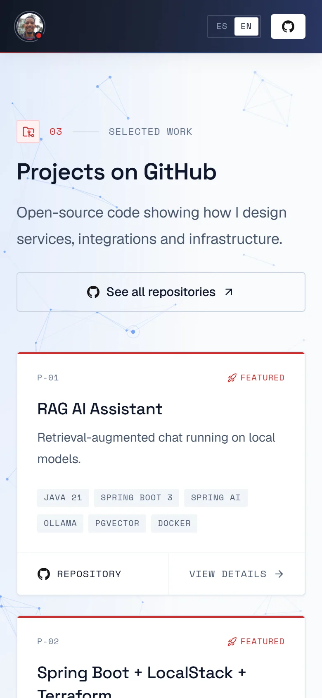<br/><sub>Projects</sub></td>
    <td align="center">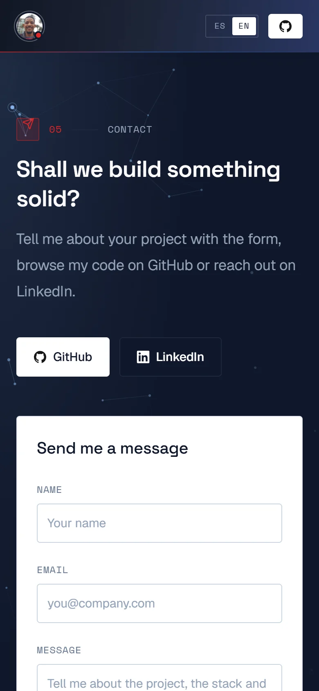<br/><sub>Contact</sub></td>
  </tr>
</table>

### Desktop

| Tech stack | Projects on GitHub |
| :---: | :---: |
| 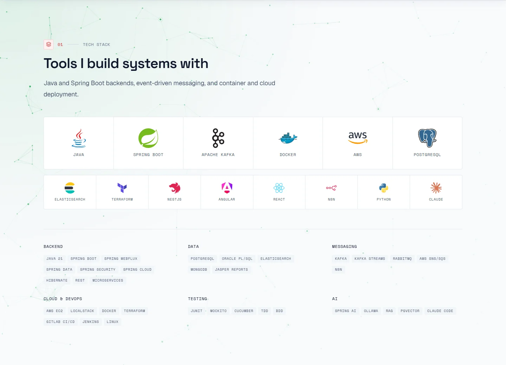 | 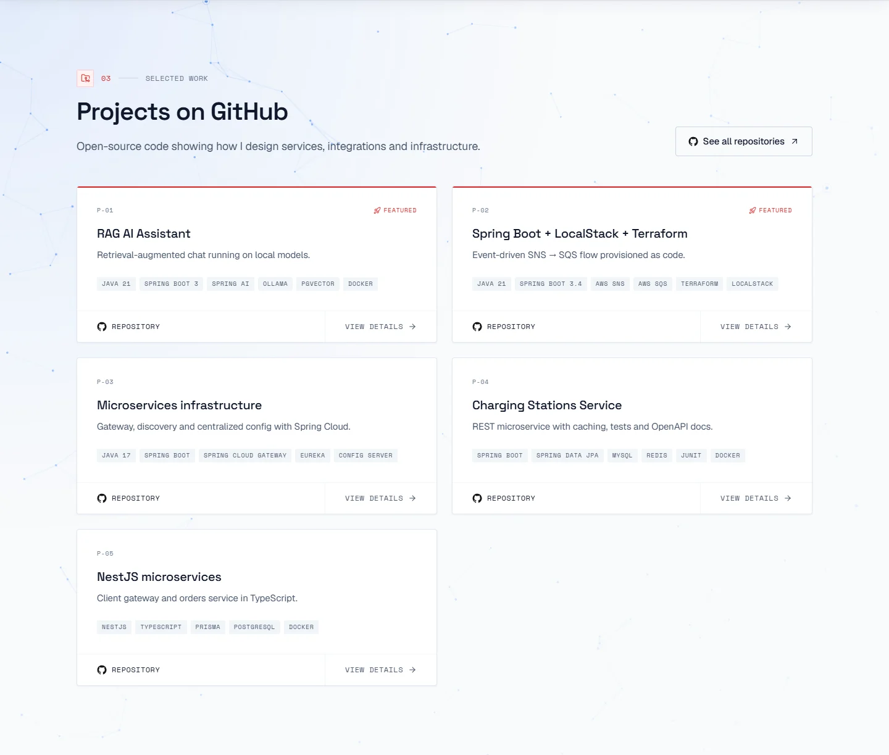 |
| **Project case study** | **Contact form** |
| 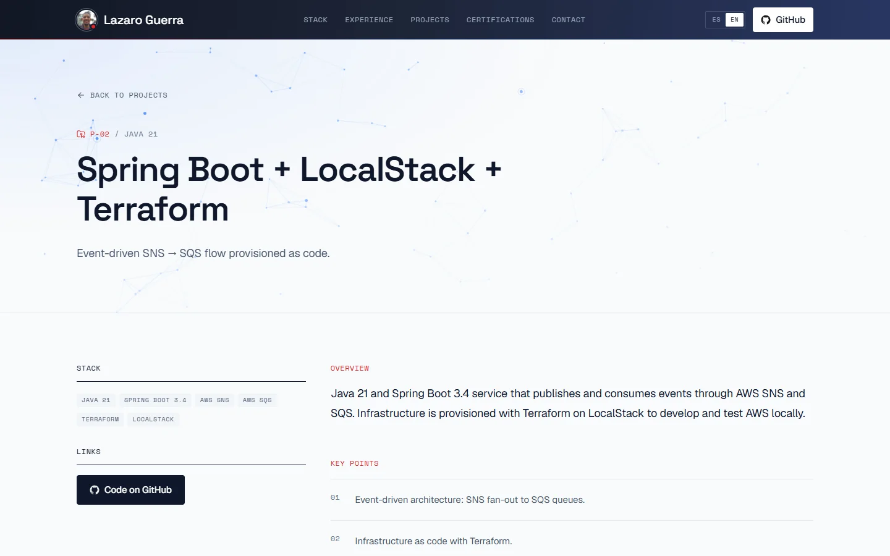 | 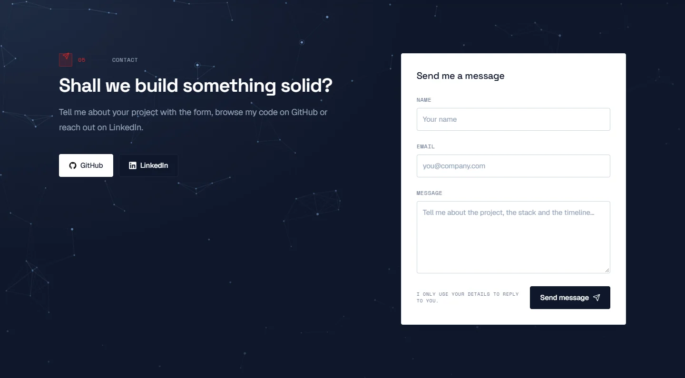 |

---

## Highlights

- **Editorial design system.** "Technical Editorial" style from [`DESIGN.md`](DESIGN.md): Space Grotesk, Geist and Space Mono, hairline grids, a navy and red palette.
- **Animated network backgrounds.** A canvas mesh of nodes and links behind each section, in a different color per section. It pauses off-screen and respects `prefers-reduced-motion`.
- **Bilingual (ES / EN).** A typed UI dictionary plus localized content. The language is detected from the browser and remembered.
- **Real content.** Experience, projects, certifications and official technology logos, all kept as typed data.
- **Project case studies.** Each `/projects/:slug` page has a metadata sidebar and a narrative column, with direct links to the GitHub repositories.
- **Working contact form.** Messages are delivered by e-mail through [Web3Forms](https://web3forms.com), with validation and a honeypot against bots.
- **Motion with care.** Scroll reveals, metric counters and hover micro-interactions, all disabled under reduced motion.
- **Ready for a backend.** Pages read content and send messages through injection tokens, so an HTTP backend can replace the static data by changing one provider.

## Tech stack

| Area | Tools |
| --- | --- |
| Framework | Angular 20: standalone components, signals, zoneless change detection, OnPush, lazy-loaded routes |
| Styling | Tailwind CSS v4 (`@theme` tokens), self-hosted fonts via `@fontsource` |
| Icons | Official [devicon](https://devicon.dev) logos, [Lucide](https://lucide.dev) line icons |
| Forms | Angular Reactive Forms + Web3Forms |
| Quality | angular-eslint, Karma + Jasmine (headless Chrome, coverage) |
| CI/CD | GitHub Actions → GitHub Pages |
| Workflow | git flow (feature, release and hotfix branches) |

## Architecture

```text
src/app
├── content/          # All real portfolio content as typed data (profile, stack, experience, projects, certifications)
├── core/
│   ├── data/         # CONTENT_REPOSITORY token + StaticContentRepository
│   ├── contact/      # CONTACT_GATEWAY token + Web3Forms implementation and config
│   ├── i18n/         # LanguageService, typed ES/EN dictionaries, `loc` and `monthYear` pipes
│   ├── layout/       # Header, footer, per-page <title>/meta
│   └── models/       # Content interfaces
├── shared/ui/        # Reusable presentational pieces: button, badge, card, avatar, icons,
│                     # project card, network background, reveal and count-up directives
└── features/         # Lazy-loaded feature "modules", each with its own *.routes.ts
    ├── home/         # Home page made of section components (hero, stack, experience, projects…)
    └── projects/     # /projects/:slug case study page
```

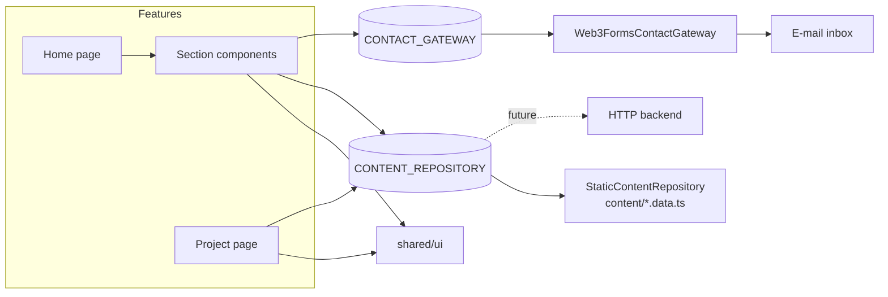

## Getting started

**Prerequisites:** Node.js **22 LTS** (Angular 20 needs ≥ 20.19 and does not support Node 26) and npm.

```bash
git clone https://github.com/LazaroDevelop/portfolio-website.git
cd portfolio-website
npm ci
npm start            # http://localhost:4200
```

### Scripts

| Command | What it does |
| --- | --- |
| `npm start` | Dev server with live reload on `http://localhost:4200` |
| `npm run build` | Production build into `dist/portfolio-website/browser` |
| `npm run build:pages` | Production build with base href `/portfolio-website/` for GitHub Pages |
| `npm run lint` | Lint TypeScript and templates with angular-eslint |
| `npm test` | Unit tests in watch mode (Karma) |
| `npm run test:ci` | Single headless test run with coverage report in `coverage/` |

Run a single spec:

```bash
npx ng test --watch=false --browsers=ChromeHeadless --include src/app/core/i18n/language.service.spec.ts
```

## Customizing

- **Content:** edit the files in [`src/app/content`](src/app/content). Every visible text is a `{ es, en }` pair.
- **UI strings:** [`core/i18n/dictionaries/es.ts`](src/app/core/i18n/dictionaries/es.ts) defines the dictionary shape, and `en.ts` must match it. The compiler checks this.
- **Technology logos:** add the SVG to `public/icons/` and reference it by file name in `stack.data.ts`.
- **Contact form:** set your Web3Forms access key in [`core/contact/contact.config.ts`](src/app/core/contact/contact.config.ts). The key is public by design. While it's empty, the form shows a "not active yet" notice and sends nothing.
- **Design tokens:** colors, fonts, shadows and type scale live in [`src/styles.css`](src/styles.css).

## CI/CD

| Workflow | Trigger | Steps |
| --- | --- | --- |
| [`ci.yml`](.github/workflows/ci.yml) | Push to `develop`, `feature/**`, `release/**`, `hotfix/**`; PRs into `develop` / `main` | Lint → unit tests (headless Chrome) → production build → coverage artifact |
| [`deploy-pages.yml`](.github/workflows/deploy-pages.yml) | Push to `main`, manual dispatch | Same checks → `build:pages` → SPA `404.html` fallback → deploy to GitHub Pages |

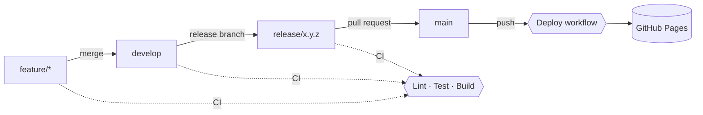

GitHub Pages has no server-side rewrites. The deploy publishes `index.html` again as `404.html`, so a deep link such as `/projects/rag-ai-assistant` loads the app, which then handles the route in the browser.

## Branching

This repository follows **git flow**:

- `feature/*` branches are merged into `develop` with `--no-ff` and are **kept** as history.
- Releases are cut from `develop` into a `release/x.y.z` branch, which is merged into `main` through a pull request.
- Every release is tagged without a `v` prefix (`1.0.0`, `1.1.0`, …).
- Merging into `main` publishes the site automatically.

## Author

**Lazaro Noel Guerra Medina**, Backend Engineer · Montevideo, Uruguay

[](https://github.com/LazaroDevelop)
[](https://www.linkedin.com/in/lazarogm13)
[](https://lazarodevelop.github.io/portfolio-website/)
